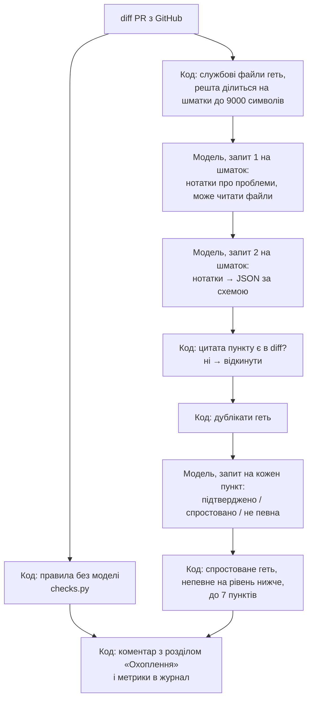

# ШІ-ревʼюер: як він влаштований

Опис будови для тих, хто ревʼюїть чи змінює `tools/ai-review/`. Як увімкнути, налаштувати й запустити: [ai-review.md](ai-review.md).

## Що це і чого воно не робить

Скрипт на Python (лише стандартна бібліотека), який GitHub Actions запускає на кожен PR. Він бере diff, питає модель
на Together AI, які в цих змінах проблеми, відсіює непідтверджене і лишає в PR **один коментар**, який оновлюється
з кожним комітом.

- Він **нічого не пише в код** і не пропонує свою реалізацію: модель отримує зміни й має назвати проблеми в них.
- Він **не блокує PR**: будь-який збій це попередження в журналі job.
- Він **не замінює** CodeRabbit і ревʼю людини. На нинішній моделі (`Qwen/Qwen3.5-9B`) він не знаходить помилок логіки рівня
  CodeRabbit (0 з 21 розміченої у вимірюванні). Користь зараз у правилах без моделі, тиші й чесному звіті про охоплення.

## Потік одного ревʼю

| Крок | Хто вирішує | Що відбувається |
|---|---|---|
| Шматки | код | Лок-файли, картинки й дані вимірювання не йдуть до моделі. Решта ділиться за файлами й блоками змін; код раніше за тести, тести раніше за документи. До 20 шматків |
| Нотатки | модель | Системний промпт, `rules.md`, опис PR, стан CI і шматок diff з номерами рядків. Модель пише проблеми звичайним текстом. Їй доступні `read_file`, `list_files`, `search_text` (до 7 звернень) |
| JSON | модель | Окремий запит без інструментів перетворює нотатки на JSON за `json_schema`. Нових проблем цей крок додавати не має |
| Цитата | код | Кожен пункт має дослівну цитату рядка. Немає такого рядка в diff цього файла: пункт відкидається як вигадка |
| Друга думка | модель | Окремий запит на пункт: твердження, зміни біля рядка і фрагмент поточного коду. Спекулятивне «може призвести» без сценарію вважається спростованим |
| Правила | код | Секрети, формат помилки, маршрут без E2E, нові залежності, код чи маршрут поза спекою. Моделі не питають |
| Коментар | код | Пункти, скільки відсіяно і чому, які файли не переглянуто і чому |

## Скільки це запитів і токенів

Виміряно на 39 ревʼю (13 PR по три прогони) поточної версії:

| | Середнє | Медіана | Від і до |
|---|---|---|---|
| Запитів до моделі на ревʼю | 13 | 11 | 2–33 |
| Токенів на ревʼю | 70 тис. | 63 тис. | 7–193 тис. |
| Час | | | 15–60 с |
| Вартість | 0,012 $ | | |

Кількість запитів: **2 на шматок, плюс 1 на кожен пункт, що дожив до другої перевірки, плюс 1 на підсумок**. PR на 3 файли
це 2 запити, PR на 38 файлів це 33. Близько 95% токенів це вхід: системний промпт і `rules.md` повторюються в кожному запиті.

Запити шматків між собою незалежні, тож ідуть паралельно (3 одночасно).

## Наскільки це «агент»

Чесно: майже ні.

- У коді є цикл «модель просить інструмент, скрипт виконує, результат повертається моделі», і модель сама вирішує, чи
  читати файли.
- На практиці вона цього не робить. З 512 запитів у вимірюванні лише близько 10 були додатковими (звернення до
  інструментів чи повтори), тобто 2%. З вимкненими міркуваннями Qwen3.5-9B відповідає одразу з того, що бачить у шматку.
- З увімкненими міркуваннями вона користується інструментами частіше, але відповіді обрізаються лімітом токенів:
  57% файлів лишались без ревʼю, а час доходив до 390 с за бюджету 420 с.
- Що дивитись і в якому порядку, вирішує код (шматки), а не модель. Модель не бачить PR цілком і не планує ревʼю.

Тобто зараз це **конвеєр із фіксованих кроків**, де модель відповідає на вузькі питання, а код перевіряє її відповіді.
Так зроблено свідомо: мала модель у вільному циклі багато вигадувала, а конвеєр це стримує. Ціна в тому, що ревʼю не
глибше за один шматок diff.

Справді агентний варіант (модель сама відкриває змінені файли, шукає виклики, сама вирішує, коли досить, і здає пункти
викликом інструмента) потребує моделі, яка стабільно викликає інструменти й тримає довгий контекст. Вимірювання для
такого порівняння готове: достатньо змінити `TOGETHER_MODEL` і прогнати `eval`.

## Пакетна обробка (batch)

- Запити нотаток до різних шматків незалежні, тож їх можна відправити одним пакетом. Далі йшли б ще два пакети: JSON і
  друга перевірка. Цикл з інструментами в пакет не вкладається, бо наступний запит залежить від відповіді на попередній.
- Вікно виконання пакета в Together 24 години, тож коментар зʼявлявся б не за хвилину, а через години. Для ревʼю PR
  це гірше, ніж економія: одне ревʼю коштує близько 0,012 $.
- Де пакет доречний: прогони вимірювання. Саме вони дали основний обсяг (близько 6,8 тис. запитів і 39 млн токенів
  за час налаштування), і там затримка не заважає.
- Дешевший за пакет шлях для звичайних ревʼю: зменшити вхід. Системний промпт і правила зараз повторюються в кожному запиті.

## Вимірювання якості

`tools/ai-review/eval/` ганяє ревʼюер на 13 розмічених PR без публікації й рахує: знайдено реальних проблем із 21,
хибні пункти, частку непереглянутих файлів, час і вартість. Зміна лишається, якщо метрики не гірші за попередню версію
з поправкою на розкид між прогонами. Подробиці й обмеження: [ai-review.md](ai-review.md#вимірювання-якості),
шаблон міток: [tools/ai-review/eval/README.md](../tools/ai-review/eval/README.md).

| | До змін | Зараз |
|---|---|---|
| Знайдено розмічених проблем | 0 (збіги за словом, не по суті) | 0 |
| Хибних пунктів на 13 PR | до 24,5 | 0–1 |
| Не переглянуто файлів | 30% | 0–4% |
| Найдовше ревʼю | близько 6 хв | до 1 хв (у вимірюванні до 2 хв під навантаженням) |

## Файли

| Файл | Що в ньому |
|---|---|
| `tools/ai-review/review.py` | Увесь конвеєр: GitHub, шматки, запити до моделі, перевірка пунктів, коментар, метрики |
| `tools/ai-review/checks.py` | Правила без моделі |
| `tools/ai-review/rules.md` | Правила проєкту й приклади хибних зауважень: потрапляють у кожен запит |
| `tools/ai-review/eval/` | Вимірювання: кейси, прогін, підрахунок, результати |
| `tools/ai-review/test_*.py`, `fakes.py` | Тести на підставному API, без ключа й мережі |
| `.github/workflows/ai-review.yml` | Запуск на PR |

## Безпека

- Опис PR, diff, спеки й нотатки моделі подаються як недовірені дані; у промптах заборонено виконувати інструкції з них.
- У моделі лише інструменти читання. Вони не виходять за межі репозиторію і не читають `.git`, `.env*`, `node_modules`.
- Значення знайденого секрету в коментар не потрапляє: цитата маскується.
- Ключ Together береться лише з секретів Actions, у журнали й метрики не пишеться.
- Workflow не працює для PR з форків.
